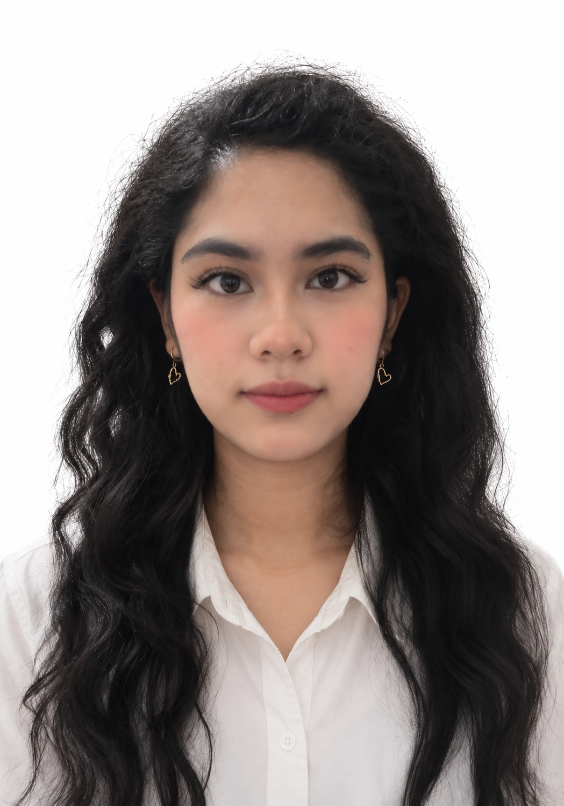

Hello, I’m Damia Iman! 👋

Welcome to my GitHub profile! I’m someone who is passionate about programming and software development.

⸻

🚀 About Me

* 🎓 Education / Status: Currently studying data engineering at Universiti Teknologi Malaysia.
* 💡 Main Interests: Web Development and Software Development.
* 🌱 Currently Learning: Git, GitHub, C++ and AWS Cloud.
* 📬 Contact Me: damiaiman@graduate.utm.my 

⸻

🛠️ Skills & Tools

* Programming Languages: HTML, C++, JavaScript, Python
* Version Control: Git & GitHub

⸻

⚡ Fun Fact

* Outside of my studies, I enjoy exploring alot! So anyone who enjoys it aswell, hit me up so we can adventure together 😼
